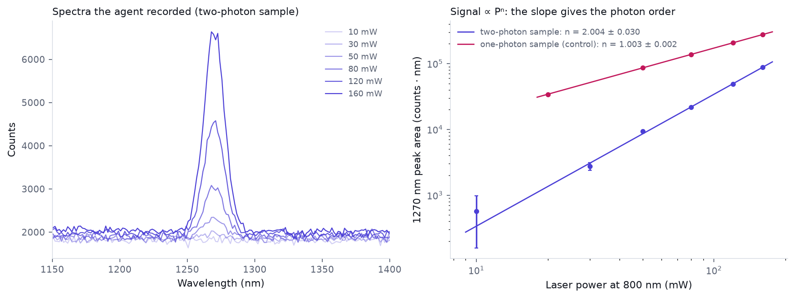

# photonics-lab-mcp

[](https://github.com/sadanbermudez/photonics-lab-mcp/actions/workflows/ci.yml)

An MCP server that lets an AI agent run a photophysics experiment on an optics bench: set laser power, arm and fire the laser, configure a spectrometer, acquire spectra, fit peaks and fit a power law. Safety limits are enforced in the server, not left to the model, and every action, including every refused one, goes into a lab notebook.

**What is real and what is simulated.** The bench in this repo is a physics simulator: an 800 nm laser exciting a photosensitiser, with singlet-oxygen phosphorescence at 1270 nm read by a 512-pixel InGaAs spectrometer (Poisson shot noise, read noise, dark current, saturation). The tool surface, safety layer, analysis and notebook are the same code a real bench would use. A real instrument driver (Thorlabs PM100 power meter, SCPI over VISA) is included and tested against `pyvisa-sim`; it has not yet been run against hardware.



## The experiment

The agent gets one question and the tools, with no procedure:

> The bench excites a photosensitiser with an 800 nm laser and records emission near 1270 nm. Determine experimentally whether this emission is excited by one-photon or two-photon absorption, and state your conclusion with its uncertainty.

The answer is in the physics: signal scales as P^n, where n is the number of photons absorbed per excitation. That rule is not the hard part, and the agent is not left to discover it: the fit tool's description says what an exponent of 1 or 2 means, and the tool returns a verdict from its own statistics. The agent has to choose powers and integration times that keep the detector out of saturation, take the spectra, fit the peaks, fit the power law and conclude. The photon order is hidden in the server (`--photon-order`), so the same question has a right answer that differs between runs.

## Results

Two runs, a local model (Qwen3.6-35B-A3B, Q4_K_M, llama.cpp on Vulkan on an AMD Radeon 8060S laptop iGPU), driving the server over stdio. Full transcripts and the raw bench data are in [examples/runs](examples/runs).

| Hidden truth | Agent's measured exponent | Tool calls | Time | Verdict |
|---|---|---|---|---|
| two-photon | 2.004 ± 0.03 (6 powers, 10–160 mW) | 28 | 91 s | correct |
| one-photon (control) | 1.003 ± 0.002 (5 powers, 20–160 mW) | 32 | 84 s | correct |

Both conclusions are right, and the control matters: with the truth hidden in the server, reciting the "two-photon at 800 nm" answer the setup suggests would have failed it. What the control shows is that the agent designed and ran a measurement good enough for the server's statistics to reach the right verdict; the verdict wording itself comes from the fit tool, and the agent repeated it. Design reasoning for every part of the server: [docs/DECISIONS.md](docs/DECISIONS.md).

**What the agent got wrong.** The measurements and fits are sound; the closing physics is not, in both runs.

- Two-photon run: it took no dark spectrum, and it explained the result as "consistent with the ~3.1 eV energy gap to the singlet oxygen emission". The 3.1 eV is the sensitiser's excitation; the 1270 nm emission is 0.98 eV, and the energy reaches oxygen by transfer from the sensitiser's triplet.
- Control run: it said singlet oxygen is "typically excited via one-photon absorption from the triplet state". Singlet oxygen is produced by energy transfer from the sensitiser triplet, not by absorption; the photon order describes how the sensitiser is excited.

So the agent is a reliable operator and a careless interpreter.

**Batch of 10 runs** ([docs/batch-eval.md](docs/batch-eval.md)): photon order 1 and 2, five seeds each, scored automatically. The closing verdict matched the hidden truth in 9 of 10 runs (Wilson 95% interval 0.60 to 0.98); the miss ran out of its 40 rounds before concluding. The fitted exponent was within 3 sigma of the truth in 9 of 10, no run saturated the detector or was refused, 9 of 10 took a dark spectrum, and 6 of 10 closing texts contain sentences flagged for a human to check the physics. That is the case for this design: the server owns the safety limits and the statistics, and a human checks the interpretation.

## Tools

| Tool | What it does | Tier |
|---|---|---|
| `bench_status` | Laser, spectrometer and safety state | read_only |
| `lab_notebook` | Last N notebook entries, including refusals | read_only |
| `analyse_peak` | Gaussian on a linear baseline: centre, width, area ± error, SNR, saturation flag | read_only |
| `fit_power_dependence` | Weighted log-log fit, exponent ± error (scaled by reduced chi²), interpretation | read_only |
| `configure_spectrometer` | Integration time and averages, within limits | configure |
| `acquire_spectrum` | Records a spectrum, saves CSV and JSON metadata | configure |
| `set_laser_power` | Sets the power setpoint, capped by the safety config; does not emit | configure |
| `arm_laser`, `laser_emission` | Arm, then switch emission on or off (off is always allowed) | full |
| `safe_state` | Emission off, disarmed; always allowed | all |

Safety: a power cap (default 200 mW, hardware max 500), integration and averaging caps, a two-step arm then emit, and permission tiers so a read-only client cannot touch the laser. If a tool raises an unexpected error, the server puts the bench in its safe state before returning.

## Run it

```
python -m venv .venv
.venv\Scripts\pip install -e .
.venv\Scripts\python -m pytest            # 27 tests
photonics-lab --tier full --data-dir data # stdio MCP server
```

Options: `--tier read_only|configure|full`, `--max-power-mw`, `--seed`, `--photon-order 1|2`, `--http --port 8771` for a local HTTP transport.

Agent demo against any OpenAI-compatible endpoint:

```
python examples/agent_demo.py --base-url http://127.0.0.1:18434/v1 --model <id> --key-file <path> --photon-order 1
python examples/make_figure.py examples/runs/<two-photon run> examples/runs/<one-photon run>
```

## Layout

- `src/photonics_lab/sim.py`: the bench physics
- `src/photonics_lab/analysis.py`: peak fit and power-law fit
- `src/photonics_lab/bench.py`: safety, state, run storage, notebook
- `src/photonics_lab/server.py`: the MCP tools
- `src/photonics_lab/drivers/pm100.py`: Thorlabs PM100 SCPI driver
- `tests/`: bench, analysis, safety and driver tests (driver against `tests/pm100_sim.yaml`)

## Next

- Run the PM100 driver on hardware and put a real power reading into the loop.
- A spectrometer driver behind the same `acquire_spectrum` interface.
- An interpretation check: a second model, or a rule set, that reviews the agent's closing physics against the measured numbers.

Built with AI assistance (Claude Code), directed and reviewed by Sergio Adan Bermudez.
